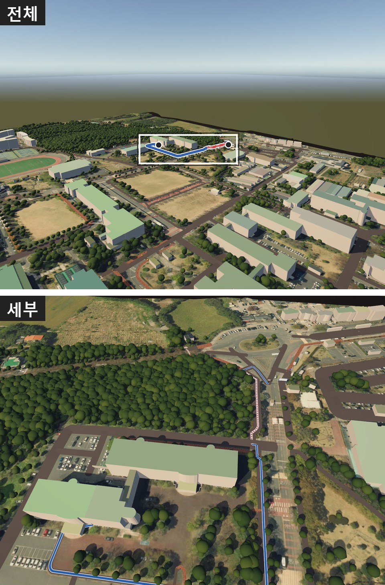

# 길동무 (Gildongmu)

휠체어·유모차 이용자를 위한 맞춤형 안전경로 추천 시스템

제주대학교 컴퓨터공학전공 팀 **길동무**

'길동무'는 휠체어·유모차 이용자가 출발 전에 갈 수 있는 길과 막힌 이유를 알 수 있게 돕는 동선 추천 서비스입니다. 휠체어·유모차는 2 cm의 작은 턱에도 지나가지 못하지만 일반 지도는 이를 알려 주지 않습니다. 측정 앱으로 경사·턱 같은 길 정보를 재서 채우고, 이동 유형에 맞는 경로와 막힌 이유를 함께 안내합니다. 제주대학교(현실 3D)와 제주민속촌(가상 3D)에 적용했습니다.

## 구성

| 부분 | 내용 | 위치 |
|---|---|---|
| 측정 앱 | 걸으며 길의 경사·턱·폭을 재어 기록하는 웹앱 | [Barrier-free-information-gathering-app](https://github.com/lumos0107/Barrier-free-information-gathering-app) |
| 경로 추천 엔진 | 잰 길 정보로 이동 유형별 경로를 찾고 이유를 설명 | 이 저장소 `DataPrep/` |
| 3D 맵 | 길 정보와 추천 경로를 3D로 보여 주는 Unity 장면 | 이 저장소 `Assets/Editor/Gildongmu/` |

## 화면



국가 공개 지도로 만든 제주대학교 3D 맵과 추천 경로 (위: 전체, 아래: 확대)


이동 유형에 맞춘 추천 길과 그 이유, 갈 수 있는 길이 없을 때 막힌 이유를 알려 주는 추천 앱 화면 (시제품)

## 경로를 고르는 방법

1. **이동 유형**: 수동 휠체어, 전동 휠체어, 유모차 가운데 하나를 고릅니다.
2. **길 조각 판정**: 길을 조각으로 나누어 유형마다 '갈 수 있음 · 불확실 · 막힘'으로 판정합니다.

   | 항목 | 불확실 | 막힘 |
   |---|---|---|
   | 앞뒤 경사 | 수동 4.5\~5.0°, 전동 5.5\~5.9° | 수동 5.0° 초과, 전동 5.9° 초과 (유모차는 막지 않고 부담으로만 셈) |
   | 턱 | 18\~22 mm | 22 mm 초과 |
   | 길 폭 | 80\~90 cm | 80 cm 미만 |
   | 틈 (진행 방향과 나란한 것) | 10\~13 mm | 13 mm 초과 (틈을 피해 남는 폭이 80 cm 이상이면 막지 않음) |
   | 계단 · 못 감 구간 · 끊긴 길 · 출입 금지 | | 막힘 |
   | 아직 다 재지 못한 구간 | 불확실 | |

3. **추천 길 세 가지**: 다익스트라 알고리즘으로 아래 세 길을 찾습니다. 각 항목의 부담은 '더 걷는 미터'로 바꿔 거리에 더하고, 이동 유형마다 배수를 다르게 둡니다(`DataPrep/route_weights.json`).
   - 빠른 길: 거리만 봅니다.
   - 편한 길: 앞뒤 경사, 좌우 기울기, 거친 노면, 낮은 턱, 좁은 길, 쉴 곳 없는 긴 오르막을 피합니다.
   - 안전한 길: 차량과 함께 쓰는 길, 낙차 옆, 차량 진출입부, 확인 안 된 구간을 피합니다.
4. **결과 설명**: 길마다 판정 이유(예: "앞뒤 5.2°", "계단")와 부담 항목을 함께 내고, 갈 수 있는 길이 없으면 어느 구간이 왜 막혔는지 냅니다. 앱 화면은 이 결과를 문장으로 바꿔 보여 줍니다.

엔진은 대상지와 상관없이 같은 형식의 경로 입력 파일만 받습니다. 측정 앱으로 실제 값을 재면 이 입력 파일만 바꾸면 되도록 만들었습니다.

## 대상지

- **제주대학교 (현실 3D)**: 국가 공개 수치지도(1:1,000·1:5,000)와 OpenStreetMap으로 길 연결망과 3D 맵을 만들었습니다. 지도에서 얻지 못한 값(일부 경사·장애물 등)은 가상 값으로 채웠습니다.
- **제주민속촌 (가상 3D)**: 실측 전이라, 길 연결망 위에 경사·턱·장애물을 가상 값으로 넣은 3D 세계를 만들고 엔진과 측정 기록 처리 과정을 시험했습니다.

## 폴더 구성

| 위치 | 내용 |
|---|---|
| `DataPrep/route_engine.py` | 길 조각 판정, 다익스트라 경로 탐색, 결과와 이유 만들기 |
| `DataPrep/route_cost.py`, `route_weights.json` | 추천 길 세 가지의 부담(가중치) 계산 |
| `DataPrep/route3_report.py` | 세 길 비교 보고 |
| `DataPrep/measure_priority.py` | 실측할 때 먼저 잴 구간 순서 정하기 |
| `DataPrep/virtual_world.py`, `virtual_obstacles.py`, `virtual_events.py` | 제주민속촌 가상 세계와 가상 측정 기록 만들기 |
| `DataPrep/jejunu/` | 제주대 길 연결망, 지형, 시설, 장애물, 3D 설계도 만들기 |
| `DataPrep/tests/`, `DataPrep/jejunu/tests/` | 시험 |
| `Assets/Editor/Gildongmu/` | Unity 에디터 스크립트: 3D 맵 만들기(`JejunuMaker`, `MinsokchonMaker`), 추천 경로 색칠(`RouteView`), 가상 세계 높이 계산과 점검(`VirtualWorld`, `VirtualCheck`) |

## 기술

| 부분 | 기술 |
|---|---|
| 경로 엔진·자료 처리 | Python 3, NumPy, SciPy, Shapely, Pillow |
| 3D 맵 | Unity 6 (URP), C# 에디터 스크립트 |
| 측정 앱 | 웹앱 (JavaScript), Supabase |

## 실행과 시험

```bash
python -m pytest DataPrep/tests
python -m pytest DataPrep/jejunu/tests
```

이 저장소에는 코드만 있습니다. 지도·항공사진·측정 기록·결과 파일은 자료마다 이용 조건이 있어 넣지 않았고, 코드는 팀 PC의 자료 위치를 가리킵니다. 그래서 자료 파일이 필요 없는 시험(판정·가중치 계산 등)만 이 저장소만으로 돌아갑니다. 2026-11-22 기준으로 자료 없이 196개가 통과하고, 나머지는 자료 파일이 없어 건너뛰거나 실패합니다.

## 앞으로

- 제주민속촌 실측 값을 받아 가상 값을 실제 값으로 바꾸는 것을 목표로 합니다.
- 지금은 이동 유형별로 정한 기준을 쓰고, 다음 단계로 사람마다 다른 기준을 반영하는 개인화를 계획하고 있습니다.
