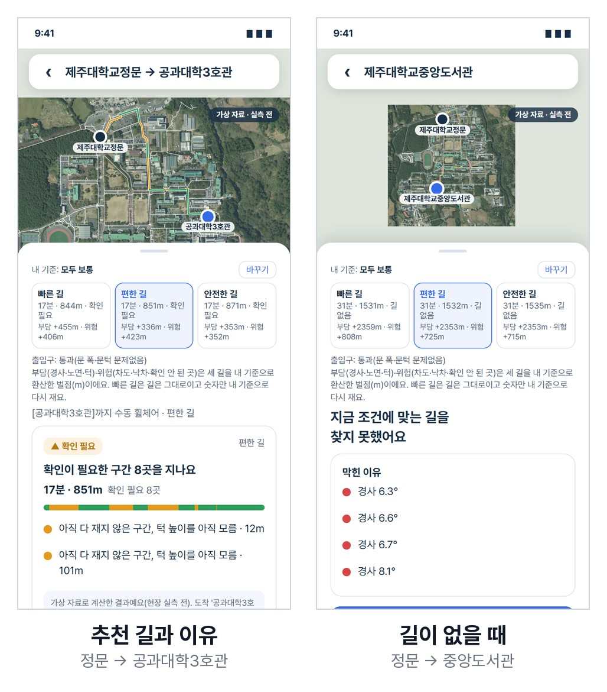

# 길동무 (Gildongmu)

휠체어·유모차 이용자를 위한 맞춤형 안전경로 추천 시스템

제주대학교 컴퓨터공학전공 팀 **길동무**

| 이름 | 맡은 일 |
|---|---|
| 강승준 (팀장) | 전체 총괄, AI 학습 기반 경로 고도화, 3D 검증 환경 |
| 이은 | 경로 알고리즘(접근성 속성·비용함수 설계, 경로 산출 엔진), 앱 화면 설계 |
| 양인권 | 측정 매뉴얼과 현장 실측 총괄, 실측 도구 관리, 측정 기록 정리 |
| 염지석 | 측정 앱과 동선 추천 앱 개발 |

(역할은 2026-11-16 캡스톤디자인 신청서의 역할 분담 기준입니다.)

'길동무'는 휠체어·유모차 이용자가 출발 전에 갈 수 있는 길과 막힌 이유를 알 수 있게 돕는 동선 추천 서비스입니다. 휠체어·유모차는 몇 cm의 턱이나 가파른 경사에도 막힐 수 있지만, 일반 지도는 이를 알려 주지 않습니다. 측정 앱으로 경사·턱 같은 길 정보를 재고, 그 값으로 이동 유형에 맞는 경로와 막힌 이유를 함께 안내하도록 만들고 있습니다. 제주대학교(현실 3D)와 제주민속촌(가상 3D)에 적용했습니다.

## 지금 상태 (2026-11-22)

| 항목 | 제주대학교 | 제주민속촌 |
|---|---|---|
| 길 연결망·건물 | 국가 수치지도(1:1,000), OpenStreetMap, 지도에 없는 보행로는 항공사진을 보고 보탬 | 온라인 공개 정보로 만든 연결망 |
| 앞뒤 경사 | 지도의 땅 높이로 추정 | 가상 값 |
| 턱 | 자리는 1:1,000 지도의 실제 위치, 높이는 가상 값 | 가상 값 |
| 좌우 기울기·노면·장애물 | 가상 값 | 가상 값 |
| 현장 실측 | 측정 앱과 실측 도구로 현장 실측함. 실측 값은 아직 엔진에 넣지 않음 | 아직 안 함 |
| 이용자 시험 | 아직 안 함 | 아직 안 함 |

그래서 아래 화면과 결과는 실측 값이 아니라 위 값으로 계산한 것입니다. 앱 화면에는 '가상 자료 · 실측 전'을 표시합니다.

## 구성

| 부분 | 내용 | 위치 |
|---|---|---|
| 측정 앱 | 걸으며 길의 경사·턱·폭을 재어 기록하는 웹앱 | [Barrier-free-information-gathering-app](https://github.com/lumos0107/Barrier-free-information-gathering-app) |
| 경로 추천 엔진 | 잰 길 정보로 이동 유형별 경로를 찾고 이유를 설명 | 이 저장소 `DataPrep/` |
| 3D 맵 | 길 정보와 추천 경로를 3D로 보여 주는 Unity 장면 | 이 저장소 `Assets/Editor/Gildongmu/` |

## 화면


국가 공개 지도로 만든 제주대학교 3D 맵 위에 경로 엔진이 찾은 경로를 칠한 그림입니다. 파랑은 갈 수 있음, 주황은 확인 필요, 끊어 그린 빨강은 막힘입니다(위: 전체, 아래: 세부, 2026-11-15 가상 값 기준).




제주대학교 지도를 넣은 측정 앱과 추천 앱 화면입니다.
- 측정 앱 화면은 개발 중인 판(0.4대)입니다. 링크한 측정 앱 저장소에는 아직 그 앞의 판(0.3.2)이 올라가 있습니다.
- 추천 앱은 이동 유형에 맞춘 추천 길과 그 이유를 보여 주고, 갈 수 있는 길이 없으면 막힌 이유를 알려 줍니다. 엔진 결과를 넣어 만든 웹 시제품이며, 지도 자료가 함께 들어 있어 이 저장소에는 넣지 않았습니다.

## 경로를 고르는 방법

1. **이동 유형**: 수동 휠체어, 전동 휠체어, 유모차 가운데 하나를 고릅니다.
2. **길 조각 판정**: 길을 조각으로 나누어 유형마다 '갈 수 있음 · 불확실 · 막힘'으로 판정합니다.

   | 항목 | 불확실 | 막힘 |
   |---|---|---|
   | 앞뒤 경사 | 수동 4.5\~5.0°, 전동 5.5\~5.9° | 수동 5.0° 초과, 전동 5.9° 초과 (유모차는 막지 않고 부담으로만 셈) |
   | 턱 | 18\~22 mm | 22 mm 초과 |
   | 길 폭 | 80\~90 cm | 80 cm 미만 |
   | 틈 (진행 방향과 나란한 것) | 10\~13 mm | 13 mm 초과 (틈을 피해 남는 폭이 80 cm 이상이면 막지 않음) |
   | 계단 · 못 감 구간 · 끊긴 길 · 출입 금지 · 길이 아닌 곳 | | 막힘 |
   | 노면 '못 감' 등급 | 실측 기록은 밀어 보기로 확인하기 전까지 불확실 | 수동 휠체어 막힘 |
   | 턱·틈 높이를 모르는 곳, 아직 다 재지 못한 구간 | 불확실 | |

3. **추천 길 세 가지**: 다익스트라 알고리즘으로 아래 세 길을 찾습니다. 각 항목의 부담은 '더 걷는 미터'로 바꿔 거리에 더하고, 이동 유형마다 배수를 다르게 둡니다(`DataPrep/route_weights.json`).
   - 빠른 길: 거리만 봅니다.
   - 편한 길: 앞뒤 경사, 좌우 기울기, 거친 노면, 낮은 턱, 좁은 길, 쉴 곳 없는 긴 오르막을 피합니다.
   - 안전한 길: 차량과 함께 쓰는 길, 낙차 옆, 차량 진출입부, 확인 안 된 구간을 피합니다.
4. **결과 설명**: 길마다 판정 이유(예: "앞뒤 5.2°", "계단")와 부담 항목을 함께 내고, 갈 수 있는 길이 없으면 어느 구간이 왜 막혔는지 냅니다. 앱 화면은 이 결과를 문장으로 바꿔 보여 줍니다.
5. **사람마다 조절**: 앱에서 경사 / 바닥·턱 / 차도·위험을 각각 '덜 신경 씀 · 보통 · 많이 신경 씀'(배수 0.5 · 1 · 2)으로 고르면, 편한 길과 안전한 길을 그 사람 기준으로 다시 찾습니다. 앱 안 길찾기(`app/router.js`)는 파이썬 엔진과 같은 방식으로 계산하고, 같은 결과가 나오는지 시험으로 확인합니다(`DataPrep/tests/test_router_js.py`).

엔진은 대상지와 상관없이 같은 형식의 파일 세 개(구간표, 시설 목록, 경로 입력)를 받습니다. 측정 앱으로 실제 값을 재면 경로 입력 파일만 바꾸면 되도록 만들었습니다.

## 대상지

- **제주대학교 (현실 3D)**: 국가 공개 수치지도(1:1,000·1:5,000)와 OpenStreetMap으로 길 연결망과 3D 맵을 만들었습니다. 지도에서 얻지 못한 값(일부 경사·장애물 등)은 가상 값으로 채웠습니다.
- **제주민속촌 (가상 3D)**: 실측 전이라, 길 연결망 위에 경사·턱·장애물을 가상 값으로 넣은 3D 세계를 만들고 엔진과 측정 기록 처리 과정을 시험했습니다.

자료 출처

- 길 연결망·건물·땅 높이: 국토지리정보원 수치지도(1:1,000·1:5,000)
- 3D 맵 바닥 항공사진과 일부 건물: 브이월드(국토교통부 공간정보 오픈플랫폼)
- 길 연결망 일부: © OpenStreetMap contributors

## 폴더 구성

| 위치 | 내용 |
|---|---|
| `DataPrep/route_engine.py` | 길 조각 판정, 다익스트라 경로 탐색, 결과와 이유 만들기 |
| `DataPrep/route_cost.py`, `route_weights.json` | 추천 길 세 가지의 부담(가중치) 계산 |
| `DataPrep/route3_report.py` | 세 길 비교 보고 |
| `DataPrep/route_export.py` | 앱 안 길찾기에 쓰는 길 그래프 내보내기(조각별 판정과 부담 항목) |
| `DataPrep/three_compare.py` | 코드를 바꿀 때 세 길 결과가 그대로인지 비교 |
| `app/router.js` | 앱 안 길찾기: 사람마다 기준을 바꾸면 브라우저에서 세 길을 다시 계산 |
| `DataPrep/measure_priority.py` | 실측할 때 먼저 잴 구간 순서 정하기 |
| `DataPrep/virtual_world.py`, `virtual_obstacles.py`, `virtual_events.py` | 제주민속촌 가상 세계와 가상 측정 기록 만들기 |
| `DataPrep/jejunu/` | 제주대 길 연결망, 지형, 시설, 장애물, 3D 설계도 만들기 |
| `DataPrep/tests/`, `DataPrep/jejunu/tests/` | 시험 |
| `Assets/Editor/Gildongmu/` | Unity 에디터 스크립트: 3D 맵 만들기(`JejunuMaker`, `MinsokchonMaker`), 추천 경로 색칠(`RouteView`), 가상 세계 높이 계산과 점검(`VirtualWorld`, `VirtualCheck`) |

## 기술

| 부분 | 기술 |
|---|---|
| 경로 엔진·자료 처리 | Python 3.10 이상. 엔진 핵심은 표준 라이브러리만 쓰고, 자료 처리에 NumPy, SciPy, Shapely 2, Pillow, OpenCV, pyproj, pyshp(`requirements.txt`) |
| 3D 맵 | Unity 6 (6000.6, URP), C# 에디터 스크립트. Unity 프로젝트 설정·장면·자료는 넣지 않아 이 저장소만으로는 Unity에서 열리지 않습니다 |
| 앱 안 길찾기 | JavaScript (브라우저, 시험은 Node.js) |
| 측정 앱 | 웹앱 (JavaScript), Supabase |

## 실행과 시험

```bash
pip install -r requirements.txt
python -m pytest DataPrep/tests
python -m pytest DataPrep/jejunu/tests
```

이 저장소에는 코드만 있습니다. 지도·항공사진·측정 기록·결과 파일은 자료마다 이용 조건이 있어 넣지 않았고, 코드는 팀 PC의 자료 위치를 가리킵니다. 그래서 자료 파일이 필요 없는 시험(판정·가중치 계산·앱 길찾기 반례 등)만 이 저장소만으로 돌아갑니다. 2026-11-22 기준 결과는 아래와 같습니다.
- `DataPrep/tests`: 자료가 없는 PC에서 184개가 통과하고, 나머지는 자료 파일이 없어 실패합니다. `test_router_js.py`는 Node.js가 있어야 돌고, 없으면 그중 13개를 건너뜁니다.
- `DataPrep/jejunu/tests`: 시작할 때 팀 PC의 자료 파일을 읽어서, 자료가 없는 PC에서는 돌지 않습니다. 팀 PC에서는 33개가 통과합니다.
- 두 시험 폴더에 이름이 같은 시험 파일이 있어 폴더마다 따로 돌립니다.

## 앞으로

- 제주민속촌 실측 값을 받아 가상 값을 실제 값으로 바꾸는 것을 목표로 합니다.
- 사람마다 조절은 앱 시제품에 넣어 시험하고 있습니다. 실측 값이 들어오면 묶음과 배수가 실제 이용자에게 맞는지 확인하는 것을 목표로 합니다.
- 제주대 3D 맵에서 길이 차도를 건너는 자리를 실제 횡단보도에 맞추는 고도화를 계획하고 있습니다.
